# Thermochemical Energy Storage (TCES) Database

An open, reproducible database of **thermochemical energy storage** materials and reactions, with
comparative plots, a classification scheme, a 1D transient reactor model, an OpenFOAM packed-bed case
and machine-learning models. Thermodynamic data come from NIST-JANAF tables and open-access papers; every entry
carries its source and a verification status.

## ⭐ Where is the material database?

| What you need | File |
|---|---|
| **Thermochemical material database (65 materials)** | [`data/tces_database.csv`](data/tces_database.csv) |
| **All materials + thermophysical properties in one file** | [`data/thermophysical/materials_properties.csv`](data/thermophysical/materials_properties.csv) |
| Same data as a database file (SQLite) | [`database/tces.db`](database/tces.db) |
| References for the `ref_ids` codes | [`data/references.csv`](data/references.csv) |
| **What every other file is** | [`FILE_GUIDE.md`](FILE_GUIDE.md) |

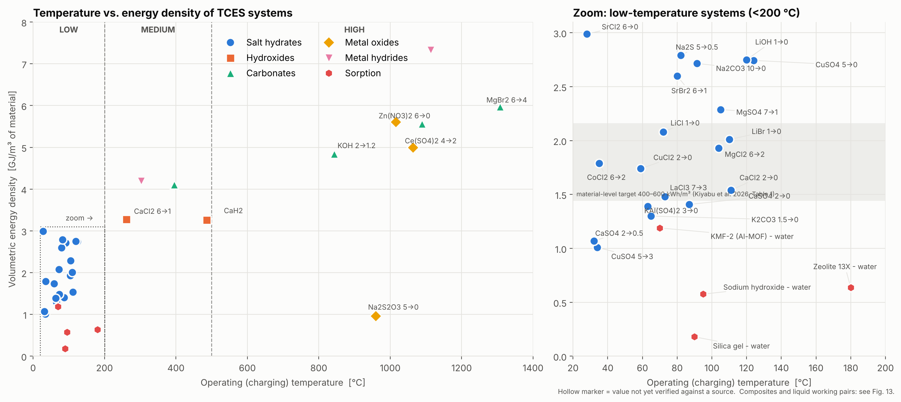

## Contents

| Folder | What is inside |
|---|---|
| `data/thermophysical/` | Material and thermophysical property CSV files |
| `data/` | Input data (`reactions_input.csv`, `thermo_species.csv`, `references.csv`) and the generated master table `tces_database.csv` |
| `database/` | SQLite schema and builder → `tces.db` (tables, foreign keys, view `v_reactions_full`) |
| `scripts/` | Property calculation, classification, comparative plots, PDF manuscript extraction |
| `figures/` | All generated figures (used in this README) |
| `docs/DATA_VERIFICATION.md` | Cross-check of the data against NIST-JANAF and open-access papers |
| `cfd/python_1d_reactor/` | 1D transient packed-bed reactor model (Python, finite volume) + case files |
| `cfd/openfoam/` | OpenFOAM `rhoPorousSimpleFoam` axisymmetric packed-bed case + setup / post-processing scripts |
| `cfd/properties.py`, `cfd/validate_cfd.py` | Shared material properties and the validation suite for both CFD models |
| `ml/` | ML models: turning temperature, energy density, material classifier, screening, reactor surrogate |
| `manuscripts/` | Put your PDF papers here for semi-automatic data extraction (PDFs are git-ignored) |

## Quick start

```bash
pip install -r requirements.txt
python run_all.py                      # rebuild data, database, figures, ML, 1D reactor cases
python run_all.py --with-surrogate     # + train the CFD surrogate (about 1-2 min)
python run_all.py --validate           # + CFD validation (add --with-openfoam if OpenFOAM is installed)

# query the database
python database/build_database.py --query "SELECT name, T_operating_C, ED_vol_GJ_m3 FROM reactions WHERE ED_vol_GJ_m3 > 2 ORDER BY ED_vol_GJ_m3 DESC"

# screen materials for a target temperature (e.g. 150 °C ± 60 °C)
python ml/tces_ml.py screen --T 150 --tol 60
```

## Classification

TCES systems are divided by **how the energy is stored** (bond type), then by **phases involved**, then by
**reaction mechanism**. Temperature class (low < 200 °C, medium 200–500 °C, high > 500 °C) is a cross-cutting label.

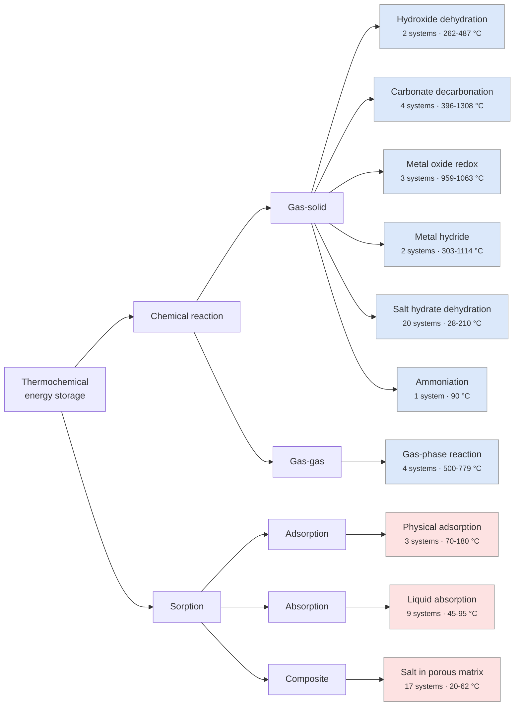

| Level | Criterion | Classes |
|---|---|---|
| 1. Family | Type of bond broken on charging | **Sorption** (physical bond / solution) · **Chemical reaction** (chemical bond) |
| 2. Sub-family | Phases | Adsorption (solid surface) · Absorption (liquid) · Gas–solid · Gas–gas (homogeneous) |
| 3. Mechanism | Reaction type | Salt-hydrate dehydration · Hydroxide dehydration · Carbonate decarbonation · Metal-oxide redox · Metal hydride · Ammoniation · Gas-phase reaction · Physical adsorption · Liquid absorption |
| Cross-cut | Operating temperature | Low (< 200 °C, buildings / district heat) · Medium (200–500 °C, industrial heat) · High (> 500 °C, CSP / power) |

## Comparative plots

| | |
|---|---|
| 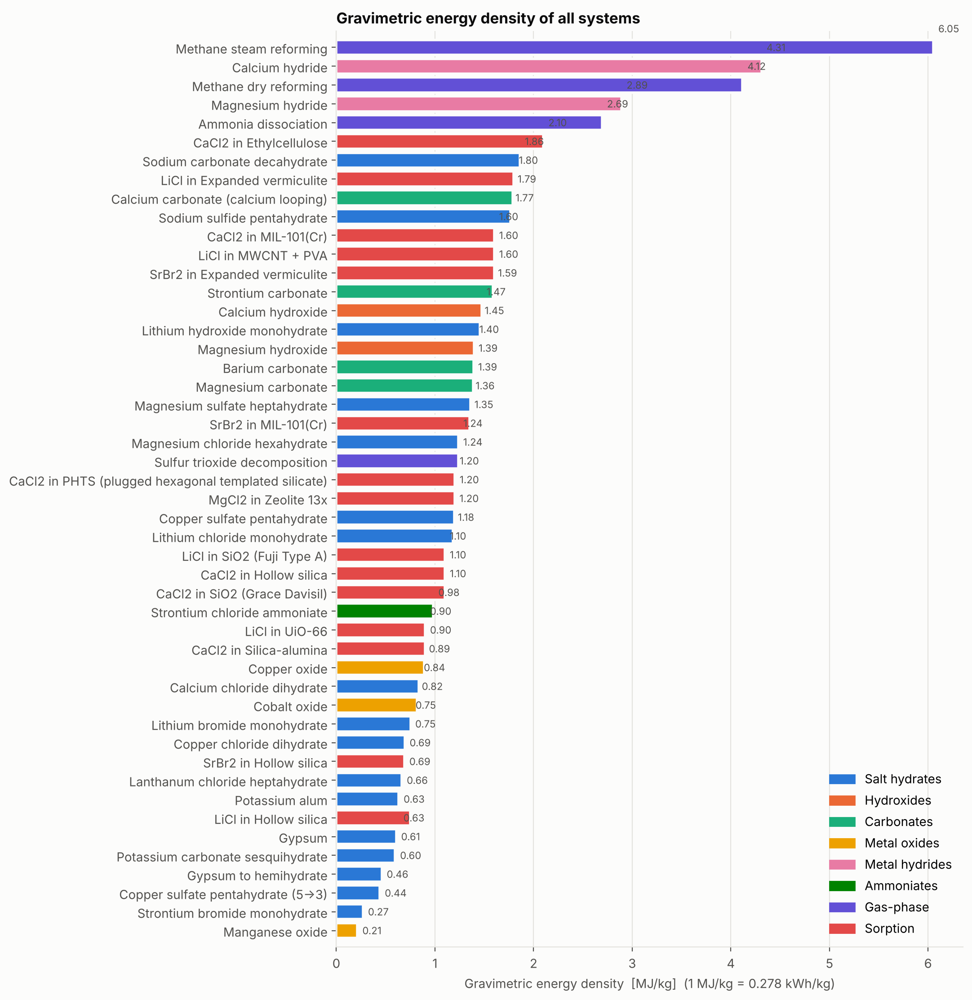 | 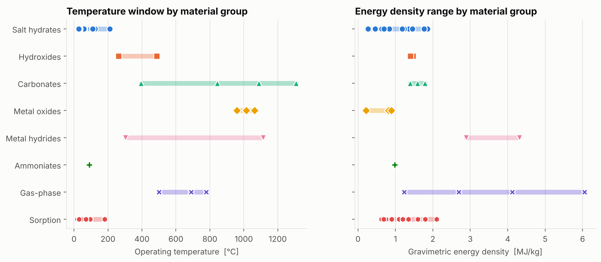 |
| 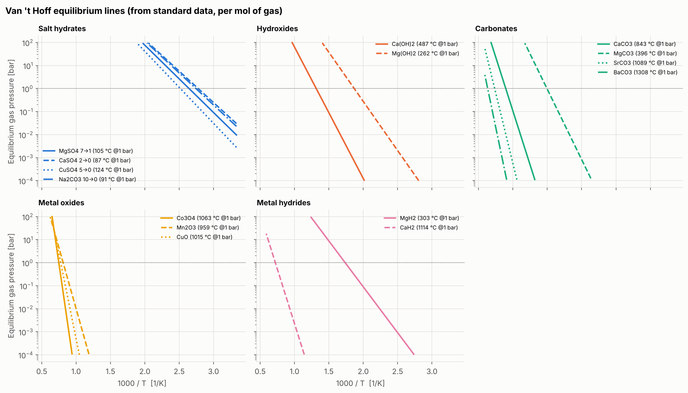 | 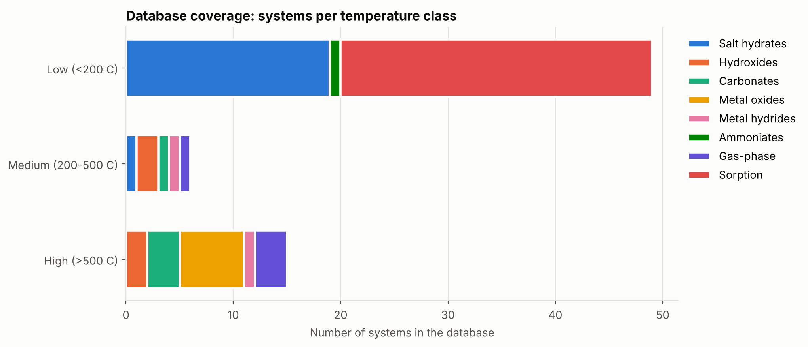 |

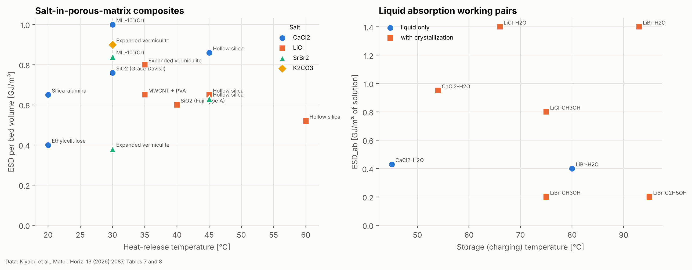

How to read them:
* **Fig. 1** (top): each point is one storage system. Pick your application temperature on the x-axis and look up which material groups can store the most energy per m³.
* **Fig. 2**: ranking by energy per kg (gas-phase reactions refer to kg of feed gas).
* **Fig. 3**: the temperature window and energy-density range of every material group in one view.
* **Fig. 4**: Van 't Hoff lines, ln p = −ΔH/RT + ΔS/R. Where a line crosses 1 bar is the turning temperature; a lower gas pressure lowers the charging temperature.
* **Fig. 5**: how many systems the database currently covers per temperature class.
* **Fig. 13**: salt-in-porous-matrix composites (energy per m³ of bed vs heat-release temperature) and liquid absorption working pairs (energy per m³ of solution vs charging temperature), from Kiyabu et al. 2026.
* The grey band in Fig. 1 (zoom) is the material-level target of 400–600 kWh/m³ for domestic storage (Kiyabu et al. 2026, Table 1).

## Database

**65 systems** with thermodynamic properties, energy densities, cyclability notes, main issues, references (DOIs)
and a **verification status for every entry**. Full cross-check report: [`docs/DATA_VERIFICATION.md`](docs/DATA_VERIFICATION.md).
`ref_ids` lists the reference codes of each entry; the codes are resolved in [`data/references.csv`](data/references.csv).

| id   | name                                                 | mechanism                |   T_operating_C | ED_grav_MJ_kg   | ED_vol_GJ_m3   | ED_vol_basis                       | status                  | ref_ids       |
|:-----|:-----------------------------------------------------|:-------------------------|----------------:|:----------------|:---------------|:-----------------------------------|:------------------------|:--------------|
| H01  | Calcium hydroxide                                    | Hydroxide dehydration    |             487 | 1.47            | 3.26           | crystal                            | ✅ NIST-JANAF            | R12;R3;R5     |
| H02  | Magnesium hydroxide                                  | Hydroxide dehydration    |             262 | 1.4             | 3.27           | crystal                            | ✅ NIST-JANAF            | R12;R3;R7     |
| C01  | Calcium carbonate (calcium looping)                  | Carbonate decarbonation  |             843 | 1.79            | 4.85           | crystal                            | ⚠️ NBS (not re-fetched) | R1;R12;R3;R10 |
| C02  | Magnesium carbonate                                  | Carbonate decarbonation  |             396 | 1.39            | 4.11           | crystal                            | ✅ NIST-JANAF            | R12;R3        |
| C03  | Strontium carbonate                                  | Carbonate decarbonation  |            1089 | 1.59            | 5.56           | crystal                            | ⚠️ NBS (not re-fetched) | R1;R12;R4     |
| C04  | Barium carbonate                                     | Carbonate decarbonation  |            1308 | 1.39            | 5.97           | crystal                            | ⚠️ NBS (not re-fetched) | R1;R12;R4     |
| O01  | Cobalt oxide                                         | Metal oxide redox        |            1063 | 0.82            | 4.99           | crystal                            | ✅ NIST-JANAF            | R12;R4;R9     |
| O02  | Manganese oxide                                      | Metal oxide redox        |             959 | 0.21            | 0.96           | crystal                            | ⚠️ NBS (not re-fetched) | R1;R12;R4;R9  |
| O03  | Copper oxide                                         | Metal oxide redox        |            1015 | 0.89            | 5.61           | crystal                            | ✅ NIST-JANAF            | R12;R4;R9     |
| M01  | Magnesium hydride                                    | Metal hydride            |             303 | 2.89            | 4.2            | crystal                            | ✅ NIST-JANAF            | R12;R3        |
| M02  | Calcium hydride                                      | Metal hydride            |            1114 | 4.31            | 7.33           | crystal                            | ⚠️ NBS (not re-fetched) | R1;R12;R4     |
| S01  | Magnesium sulfate heptahydrate                       | Salt hydrate dehydration |             105 | 1.36            | 2.29           | crystal                            | ⚠️ NBS (not re-fetched) | R1;R12;R2;R18 |
| S02  | Gypsum                                               | Salt hydrate dehydration |              87 | 0.61            | 1.41           | crystal                            | ⚠️ NBS (not re-fetched) | R1;R12;R2     |
| S03  | Copper sulfate pentahydrate                          | Salt hydrate dehydration |             124 | 1.2             | 2.74           | crystal                            | ⚠️ NBS (not re-fetched) | R1;R12;R2     |
| S04  | Sodium carbonate decahydrate                         | Salt hydrate dehydration |              91 | 1.86            | 2.72           | crystal                            | ⚠️ NBS (not re-fetched) | R1;R12;R2     |
| S05  | Strontium bromide hexahydrate                        | Salt hydrate dehydration |              80 | –               | 2.6            | material                           | ✅ OA paper              | R18;R2;R11    |
| S06  | Potassium carbonate sesquihydrate                    | Salt hydrate dehydration |              65 | 0.6             | 1.3            | crystal (open system, no porosity) | ✅ OA paper              | R13;R6;R18    |
| S07  | Magnesium chloride hexahydrate                       | Salt hydrate dehydration |             104 | 1.24            | 1.93           | crystal (open system, no porosity) | ✅ OA paper              | R13;R18       |
| S08  | Sodium sulfide pentahydrate                          | Salt hydrate dehydration |              82 | 1.77            | 2.79           | crystal (open system, no porosity) | ✅ OA paper              | R13;R6;R18    |
| S09  | Lithium hydroxide monohydrate                        | Salt hydrate dehydration |             100 | 1.45            | 2.19           | –                                  | ❌ not verified          | R7            |
| A01  | Strontium chloride ammoniate                         | Ammoniation              |              90 | 0.98            | –              | –                                  | ❌ not verified          | R11;R7        |
| G01  | Ammonia dissociation                                 | Gas-phase reaction       |             500 | 2.7             | –              | crystal                            | ✅ NIST-JANAF            | R12;R3        |
| G02  | Methane steam reforming                              | Gas-phase reaction       |             688 | 6.05            | –              | crystal                            | ✅ NIST-JANAF            | R12;R3        |
| G03  | Methane dry reforming                                | Gas-phase reaction       |             691 | 4.12            | –              | crystal                            | ✅ NIST-JANAF            | R12;R3        |
| G04  | Sulfur trioxide decomposition                        | Gas-phase reaction       |             779 | 1.24            | –              | crystal                            | ✅ NIST-JANAF            | R12;R3        |
| P01  | Zeolite 13X - water                                  | Physical adsorption      |             180 | –               | 0.64           | system/bed                         | ⚠️ secondary citation   | R16;R18       |
| P02  | Silica gel - water                                   | Physical adsorption      |              90 | –               | 0.18           | material (prototype)               | ⚠️ secondary citation   | R16           |
| P03  | Sodium hydroxide - water                             | Liquid absorption        |              95 | –               | 0.58           | sorbent volume                     | ✅ OA paper              | R14           |
| S10  | Lithium chloride monohydrate                         | Salt hydrate dehydration |              72 | 1.18            | 2.08           | crystal (open system, no porosity) | ✅ OA paper              | R13           |
| S11  | Lithium bromide monohydrate                          | Salt hydrate dehydration |             110 | 0.75            | 2.01           | crystal (open system, no porosity) | ✅ OA paper              | R13           |
| S12  | Calcium chloride dihydrate                           | Salt hydrate dehydration |             111 | 0.84            | 1.54           | crystal (open system, no porosity) | ✅ OA paper              | R13;R18       |
| S13  | Lanthanum chloride heptahydrate                      | Salt hydrate dehydration |              73 | 0.66            | 1.48           | crystal (open system, no porosity) | ✅ OA paper              | R13           |
| S14  | Potassium alum                                       | Salt hydrate dehydration |              63 | 0.63            | 1.39           | crystal (open system, no porosity) | ✅ OA paper              | R13           |
| S15  | Copper chloride dihydrate                            | Salt hydrate dehydration |              59 | 0.69            | 1.74           | crystal (open system, no porosity) | ✅ OA paper              | R13           |
| S16  | Cobalt chloride hexahydrate                          | Salt hydrate dehydration |              35 | –               | 1.79           | crystal (open system, no porosity) | ✅ OA paper              | R13           |
| S17  | Copper sulfate pentahydrate (5->3)                   | Salt hydrate dehydration |              34 | 0.44            | 1.01           | crystal (open system, no porosity) | ✅ OA paper              | R13           |
| S18  | Gypsum to hemihydrate                                | Salt hydrate dehydration |              32 | 0.46            | 1.07           | crystal (open system, no porosity) | ✅ OA paper              | R13           |
| S19  | Strontium bromide monohydrate                        | Salt hydrate dehydration |             210 | 0.27            | –              | –                                  | ✅ OA paper              | R15           |
| S20  | Strontium chloride hexahydrate                       | Salt hydrate dehydration |              28 | –               | 2.99           | crystal (open system, no porosity) | ✅ OA paper              | R18           |
| L01  | LiBr-H2O absorption                                  | Liquid absorption        |              80 | –               | 0.4            | solution (ESD_ab)                  | ✅ OA paper              | R18           |
| L02  | LiBr-H2O absorption (with crystallization)           | Liquid absorption        |              93 | –               | 1.4            | solution (ESD_ab)                  | ✅ OA paper              | R18           |
| L03  | CaCl2-H2O absorption                                 | Liquid absorption        |              45 | –               | 0.43           | solution (ESD_ab)                  | ✅ OA paper              | R18           |
| L04  | CaCl2-H2O absorption (with crystallization)          | Liquid absorption        |              54 | –               | 0.95           | solution (ESD_ab)                  | ✅ OA paper              | R18           |
| L05  | LiCl-H2O absorption (with crystallization)           | Liquid absorption        |              66 | –               | 1.4            | solution (ESD_ab)                  | ✅ OA paper              | R18           |
| L06  | LiBr-CH3OH absorption (with crystallization)         | Liquid absorption        |              75 | –               | 0.2            | solution (ESD_ab)                  | ✅ OA paper              | R18           |
| L07  | LiCl-CH3OH absorption (with crystallization)         | Liquid absorption        |              75 | –               | 0.8            | solution (ESD_ab)                  | ✅ OA paper              | R18           |
| L08  | LiBr-C2H5OH absorption (with crystallization)        | Liquid absorption        |              95 | –               | 0.2            | solution (ESD_ab)                  | ✅ OA paper              | R18           |
| X01  | CaCl2 in Hollow silica                               | Salt in porous matrix    |              45 | 1.1             | 0.86           | bed                                | ✅ OA paper              | R18           |
| X02  | CaCl2 in Ethylcellulose                              | Salt in porous matrix    |              20 | 2.1             | 0.4            | bed                                | ✅ OA paper              | R18           |
| X03  | CaCl2 in SiO2 (Grace Davisil)                        | Salt in porous matrix    |              30 | 1.1             | 0.76           | bed                                | ✅ OA paper              | R18           |
| X04  | CaCl2 in Silica-alumina                              | Salt in porous matrix    |              20 | 0.9             | 0.65           | bed                                | ✅ OA paper              | R18           |
| X05  | CaCl2 in PHTS (plugged hexagonal templated silicate) | Salt in porous matrix    |              30 | 1.2             | –              | bed                                | ✅ OA paper              | R18           |
| X06  | CaCl2 in MIL-101(Cr)                                 | Salt in porous matrix    |              30 | 1.6             | 1.0            | bed                                | ✅ OA paper              | R18           |
| X07  | LiCl in UiO-66                                       | Salt in porous matrix    |              40 | 0.9             | –              | bed                                | ✅ OA paper              | R18           |
| X08  | LiCl in Hollow silica                                | Salt in porous matrix    |              45 | 0.75            | 0.65           | bed                                | ✅ OA paper              | R18           |
| X09  | LiCl in Hollow silica                                | Salt in porous matrix    |              60 | 0.63            | 0.52           | bed                                | ✅ OA paper              | R18           |
| X10  | LiCl in MWCNT + PVA                                  | Salt in porous matrix    |              35 | 1.6             | 0.65           | bed                                | ✅ OA paper              | R18           |
| X11  | LiCl in Expanded vermiculite                         | Salt in porous matrix    |              35 | 1.8             | 0.8            | bed                                | ✅ OA paper              | R18           |
| X12  | LiCl in SiO2 (Fuji Type A)                           | Salt in porous matrix    |              40 | 1.1             | 0.6            | bed                                | ✅ OA paper              | R18           |
| X13  | MgCl2 in Zeolite 13x                                 | Salt in porous matrix    |              62 | 1.2             | –              | bed                                | ✅ OA paper              | R18           |
| X14  | SrBr2 in Hollow silica                               | Salt in porous matrix    |              45 | 0.69            | 0.63           | bed                                | ✅ OA paper              | R18           |
| X15  | SrBr2 in Expanded vermiculite                        | Salt in porous matrix    |              30 | 1.6             | 0.38           | bed                                | ✅ OA paper              | R18           |
| X16  | SrBr2 in MIL-101(Cr)                                 | Salt in porous matrix    |              30 | 1.35            | 0.84           | bed                                | ✅ OA paper              | R18           |
| X17  | K2CO3 in Expanded vermiculite                        | Salt in porous matrix    |              30 | –               | 0.9            | bed                                | ✅ OA paper              | R18           |
| P04  | KMF-2 (Al-MOF) - water                               | Physical adsorption      |              70 | –               | 1.19           | material                           | ⚠️ secondary citation   | R18           |

**Verification status**

| Status | Meaning | Entries |
|---|---|---|
| ✅ NIST-JANAF | ΔH, ΔS computed from NIST-JANAF tables read online (URL per species in `data/thermo_species.csv`) | 10 |
| ✅ OA paper | value copied from an open-access paper; DOI, page and table in `source_location` | 41 |
| ⚠️ NBS (not re-fetched) | computed from NBS 1982 tables; these species are not in JANAF and the NBS values have not yet been re-read from the source | 9 |
| ⚠️ secondary citation | value cited inside an open-access paper from another study | 3 |
| ❌ not verified | no open-access source found yet – check before use | 2 |

Notes
* `calc` rows: ΔH and ΔS from standard formation data at 298 K; T_eq = ΔH/ΔS at 1 bar reactive gas; energy density per kg / m³ of the **discharged** solid (crystal density).
* `lit` rows from Donkers et al. 2017 use the dehydration temperature at 20 mbar water vapour, so their temperatures are lower than 1-bar equilibrium values. Column `T_basis` states the basis of every temperature.
* Known disagreements are documented, not hidden: e.g. JANAF data give Co₃O₄ T_eq = 1063 °C and 817 kJ/kg, whereas André et al. 2017 measured ~920 °C onset and 597 kJ/kg.
* `ED_vol_basis` states what the volumetric energy density refers to (crystal, bed, solution, system), because these differ by a factor of 2–4.
* Crystal densities are CRC handbook values that have not yet been re-read from the source (`density_source`).

### Data dictionary (`data/tces_database.csv`)

| Column | Unit | Meaning |
|---|---|---|
| `dH_kJ_mol_rxn`, `dS_J_molK_rxn` | kJ/mol, J/mol/K | reaction enthalpy / entropy as written (charging direction) |
| `dH_kJ_per_mol_gas` | kJ/mol | enthalpy per mole of released gas |
| `T_eq_C` | °C | turning temperature at 1 bar gas |
| `ED_grav_MJ_kg` / `ED_grav_kWh_kg` | MJ/kg, kWh/kg | gravimetric energy density |
| `ED_vol_GJ_m3` | GJ/m³ | volumetric energy density (material level) |
| `cyclability`, `main_issue` | – | qualitative notes from the literature |
| `ref_ids` | – | keys into `data/references.csv` |

### Material and thermophysical property files (CSV)

[`data/thermophysical/`](data/thermophysical/) holds ready-to-use CSV files:

| File | Content |
|---|---|
| [`materials_properties.csv`](data/thermophysical/materials_properties.csv) | all 65 materials: molar mass, densities, Cp, ΔH, ΔS, temperatures, energy densities, volume change, DRH, sources |
| [`species_properties.csv`](data/thermophysical/species_properties.csv) | 38 chemical species: M, density, ΔfH°, S°, Cp(298 K) |
| [`species_cp_vs_T.csv`](data/thermophysical/species_cp_vs_T.csv) | Cp, S, H−H298 at 298–1200 K from NIST-JANAF |
| [`gas_properties.csv`](data/thermophysical/gas_properties.csv) | N₂/steam density, cp, viscosity, conductivity, Pr at 20–600 °C |
| [`class_property_ranges.csv`](data/thermophysical/class_property_ranges.csv) | ranges per material class (Kiyabu et al. 2026) |
| [`cfd_bed_properties.csv`](data/thermophysical/cfd_bed_properties.csv) | bed properties used in the CFD |

Empty cells mean no sourced value yet; see [`data/thermophysical/README.md`](data/thermophysical/README.md) for columns and gaps.

### Data from Kiyabu et al. 2026 (Materials Horizons review)

[`data/kiyabu2026/`](data/kiyabu2026/) holds the tables of Kiyabu, Shkatulov, Ahmed, Greene, Huinink & Siegel,
*Mater. Horiz.* 13 (2026) 2087–2126 (DOI 10.1039/d5mh01794g, CC BY-NC 4.0), copied verbatim:
performance targets (Table 1), lab-scale prototypes (Table 2), sorptive-cooling pairs (Table 3), material-class
overview (Table 4), crystal-level salt properties (Table 5), liquid working pairs (Table 7) and salt-in-matrix composites
(Table 8). In the SQLite database they are the tables `kiyabu2026_*`. From this paper the database gained SrCl₂·6H₂O,
8 liquid absorption pairs, 17 composites and KMF-2; SrBr₂·6H₂O is now verified; and heat-release temperature,
volume change, deliquescence humidity and bed-level energy density were added where reported.

### Adding data from manuscripts

1. Copy PDFs into `manuscripts/`.
2. `python scripts/extract_from_manuscripts.py` → `data/manuscript_candidates.csv` (value, unit, page, sentence, formulas) and every detected table in `data/manuscript_tables/`.
3. Check each value in the paper, then add it to `data/reactions_input.csv` (`data_mode = lit`) and the paper to `data/references.csv`.
4. `python run_all.py`.

## CFD

Both CFD models describe **the same reactor** and take their material properties from one module,
`cfd/properties.py`, so their results can be compared directly.

### Material properties used in the CFD

| Property | Value (Ca(OH)₂ discharge case) | Source / method |
|---|---|---|
| Gas | 50 % H₂O / 50 % N₂ (mole), 1 bar, 400 °C | operating condition |
| Gas molar mass | 23.01 g/mol | mole-fraction average |
| Gas density | 0.411 kg/m³ | ideal gas |
| Gas cp | 1472 J/kg·K | NIST Shomate equations (N₂, H₂O) |
| Gas viscosity | 2.82×10⁻⁵ Pa·s | Sutherland law + Wilke mixing |
| Gas conductivity / Pr | 0.050 W/m·K / 0.82 | Sutherland law + Wilke mixing |
| Bed porosity ε / granule size d_p | 0.40 / 2 mm | same in 1D and OpenFOAM |
| Granule density / solid cp | 1100 kg/m³ / 1300 J/kg·K | porous Ca(OH)₂ granules |
| Reactive solid N₀ | 8908 mol/m³ bed | (1−ε)·ρ_p / M |
| Bed ρ·cp | 8.58×10⁵ J/m³·K | (1−ε)·ρ_p·c_p |
| Bed conductivity λ_eff | 0.4 W/m·K | Ca(OH)₂ bed literature range 0.1–0.4 |
| Reaction ΔH / ΔS | 106.8 kJ/mol / 137.2 J/mol·K | Schaube et al. 2012 equilibrium fit, T_eq(1 bar) = 505 °C |
| Darcy d / Forchheimer f | 2.11×10⁸ 1/m² / 1.64×10⁴ 1/m | Ergun equation with ε and d_p |

Print the property table at other conditions: `python cfd/properties.py`.

### 1D transient packed-bed reactor (Python)

`cfd/python_1d_reactor/reactor_model.py` solves the reactive-gas mole fraction (constant total pressure,
inert carrier conserved), the bed energy balance with indirect wall heat exchange and the solid conversion
with Van 't Hoff equilibrium and Arrhenius kinetics (finite volume, method of lines, BDF).

```bash
cd cfd/python_1d_reactor
python reactor_model.py --config cases/caoh2_discharge.json --vtk   # VTK series for ParaView
python reactor_model.py --config cases/caoh2_charge.json
python reactor_model.py --config cases/mgso4_discharge.json
```

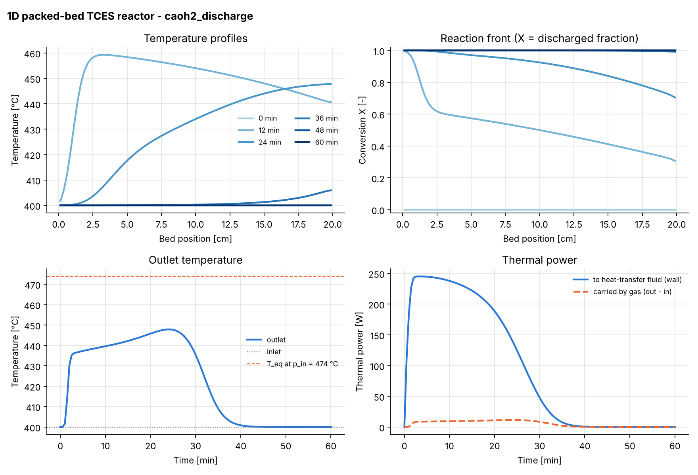

### OpenFOAM packed bed (v1912+, openfoam.com)

`cfd/openfoam/packedBedReactor` is an **axisymmetric 5° wedge** of the tube reactor (D = 50 mm): inlet plenum,
porous bed (Darcy–Forchheimer from Ergun) and outlet plenum, solved with `rhoPorousSimpleFoam`.
`setup_from_1d.py` writes the gas properties, porosity coefficients, heat source and boundary conditions
from the same 1D case file.

```bash
cd cfd/openfoam
python setup_from_1d.py                      # or --wall adiabatic for the validation set-up
cd packedBedReactor && ./Allrun && cd ..
python postprocess.py                        # maps, axial profiles, Δp vs Ergun, mass and energy balance
```

| | |
|---|---|
| 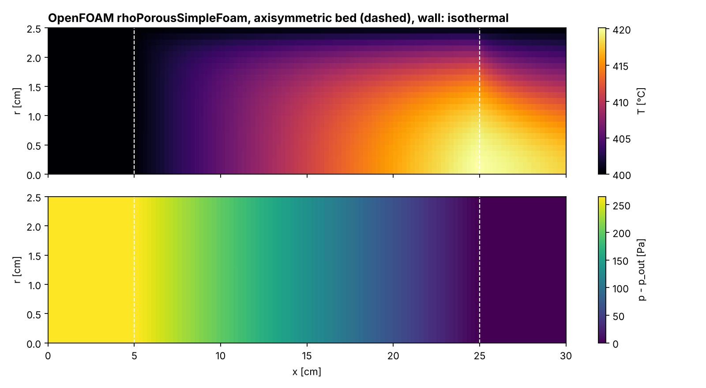 | 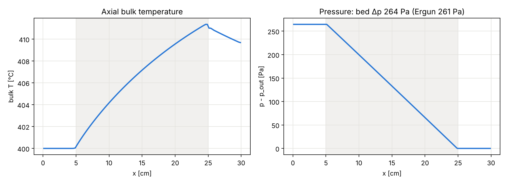 |

### Validation (both models): 19 of 19 checks passed

`python cfd/validate_cfd.py` reruns every check and writes [`cfd/VALIDATION.md`](cfd/VALIDATION.md).

| Model | Check | Result |
|---|---|---|
| 1D | Energy conservation (3 cases) | error 0.09–0.33 % |
| 1D | Grid convergence 80 → 160 cells | change ≤ 0.2 % |
| 1D | Adiabatic bed stops at T_eq(p_in) = 473.9 °C | T_max 0.97 K below T_eq, never above |
| 1D | Gas properties vs reference tables (N₂, H₂O at 400 °C) | within 2 % |
| OpenFOAM | Bed Δp vs Ergun | 1.4 % |
| OpenFOAM | Mass conservation | 0.002 % |
| OpenFOAM | Energy conservation (adiabatic wall) | 0.08 % |
| OpenFOAM | Mesh independence (3 000 → 12 000 cells) | Δp 0.7 %, ΔT 0.03 % |
| 1D ↔ OpenFOAM | Same heat input → same gas temperature rise | 0.3 % |

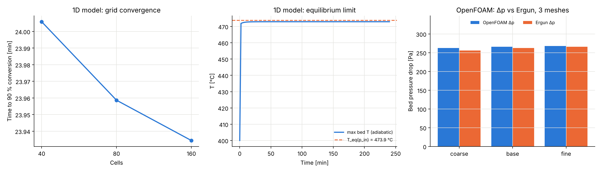

These checks verify the numerics, conservation laws, thermodynamic limits and material properties.
Kinetic parameters, effective bed conductivity and wall heat transfer still need to be fitted to
experiments (TGA and reactor temperature data) before the models are used for design.

## Machine learning

`ml/tces_ml.py` (leave-one-out cross-validation, because the dataset is small):

| Task | Best model | Score |
|---|---|---|
| Turning temperature from ΔH, gas type, molar mass, density | Gaussian process | MAE ≈ 89 °C, R² ≈ 0.90 |
| Gravimetric energy density | Linear regression | MAE ≈ 0.62 MJ/kg, R² ≈ 0.62 |
| Material-group classifier | Random forest | accuracy ≈ 86 % |
| Screening for a target temperature | weighted multi-criteria score | ranked CSV in `ml/results/` |

`ml/reactor_surrogate.py` runs the 1D reactor model about 300 times (Latin hypercube over velocity, vapour pressure,
inlet temperature, wall heat-transfer coefficient, bed length and solid loading) and trains surrogates
(test R²: time to 90 % conversion 0.94, peak power 0.998, max outlet temperature 0.99).

| | |
|---|---|
| 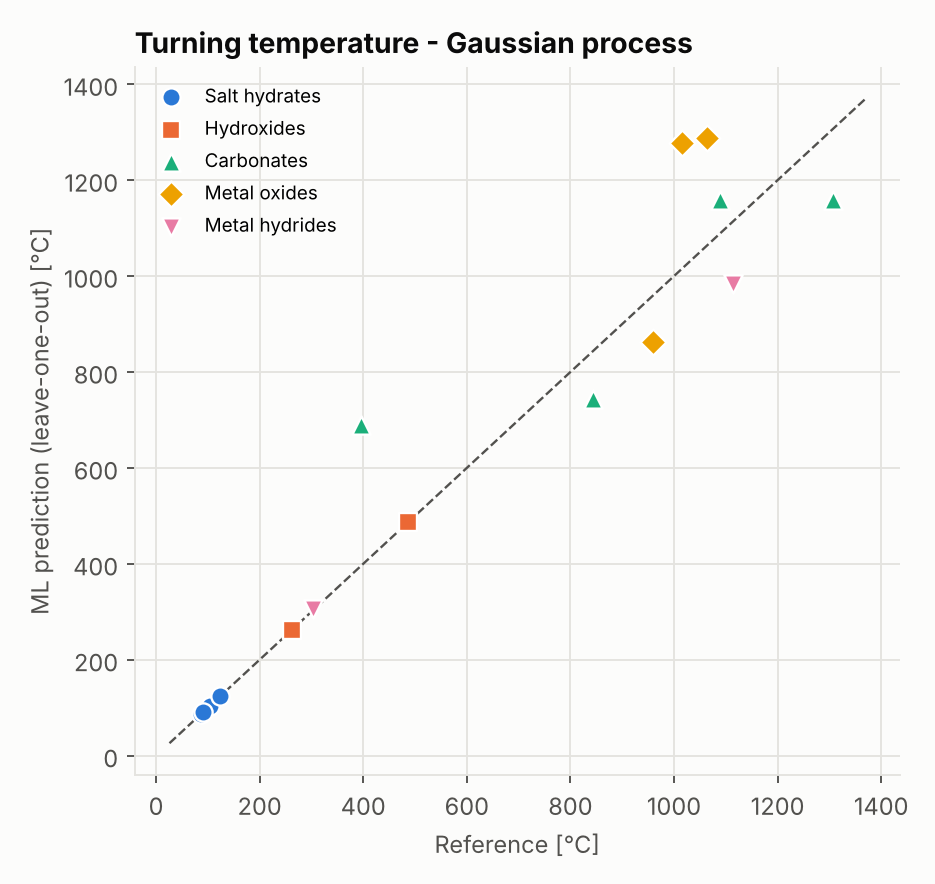 | 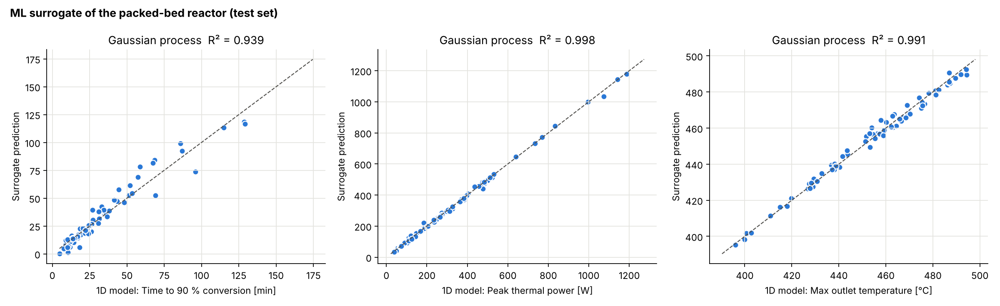 |

## Limitations

* `calc` properties use 298 K standard data; real ΔH/ΔS vary with temperature and real equilibrium data (e.g. Schaube et al. 2012 for Ca(OH)2) differ by tens of °C.
* Volumetric energy densities are for the crystal; packed beds reach roughly 40–60 % of these values.
* Kinetic parameters in the reactor cases are illustrative (order of magnitude from literature); fit them to your own TGA data before using the model for design.
* The OpenFOAM case prescribes the reaction heat (from the 1D model) and has no solid phase; full transient reaction coupling is done in the 1D model.
* ML results are indicative because the database is small; they will improve as more manuscripts are added.

## References

See `data/references.csv` (DOIs). Main sources:
N'Tsoukpoe et al., *Applied Energy* 124 (2014) 1–16 · Pardo et al., *RSER* 32 (2014) 591–610 ·
André et al., *RSER* 64 (2016) 703–715 · Schaube et al., *Thermochim. Acta* 538 (2012) 9–20 ·
Sögütoglu et al., *Applied Energy* 215 (2018) 159–173 · Yan et al., *RSER* 43 (2015) 13–31 ·
Aydin et al., *RSER* 41 (2015) 356–367 · Block & Schmücker, *Solar Energy* 126 (2016) 195–207 ·
Ortiz et al., *RSER* 113 (2019) 109252 · Solé et al., *RSER* 47 (2015) 386–398 · NBS 1982 tables ·
NIST-JANAF tables (Chase 1998) · Donkers et al., *Applied Energy* 199 (2017) 45–68 (open access) ·
Fumey et al., *Applied Energy* 335 (2023) 120755 · Stengler et al. (DLR manuscript) · Abohamzeh & Frey, *Energies* 15 (2022) 5944 ·
André, Abanades & Cassayre, *J. Solid State Chem.* 253 (2017) 6–14 ·
Kiyabu, Shkatulov, Ahmed, Greene, Huinink & Siegel, *Mater. Horiz.* 13 (2026) 2087–2126.

## License

Code: MIT. Data: CC BY 4.0, please cite the original manuscripts listed in `data/references.csv`.
